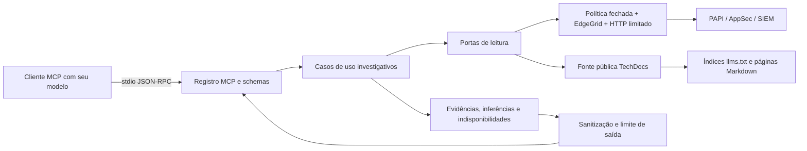

# Arquitetura implementada

**Fase 1: código e documentação completos, sem execução de validação.**

## Organização e dependências

```text
src/
  index.ts                         composição e ciclo stdio
  configuration/config.ts          variáveis, credenciais e limites
  mcp/schemas.ts                   schemas de entrada Zod
  mcp/server.ts                    21 ferramentas e respostas MCP
  application/
    ports.ts                       contratos concretos de leitura API/documentos
    context.ts                     orçamento e cancelamento por investigação
    common.ts                      composição de evidências e falhas parciais
    property-investigation.ts      casos de uso PAPI/CDN
    security-investigation.ts      casos de uso Application Security
    waf-investigation.ts           consulta SIEM e correlação de requestId
    operational-investigation.ts   hostname, 403 e mudanças de configuração
    documentation-investigation.ts busca lexical e recuperação documental
  domain/
    json.ts                        valores JSON e seleção de campos
    errors.ts                      erros públicos estruturados
    results.ts                     evidência, inferência e indisponibilidade
    read-policy.ts                 catálogo fechado de operações permitidas
    pagination.ts                  paginação local e JSON Pointer
    rules.ts                       critérios ancestrais e comparação estrutural
    siem.ts                        parsing NDJSON, facets e filtros locais
  infrastructure/
    edgegrid.ts                    signer EG1-HMAC-SHA256
    http.ts                        fetch, timeout, retry e limite de corpo
    akamai-client.ts               política, assinatura e destinos fixos
    documentation-source.ts        leitura pública de índices/páginas autorizados
    redaction.ts                   mascaramento e logs mínimos em stderr
```

O composition root cria um cliente Akamai compartilhado, casos de uso e fonte documental. As duas interfaces em `application/ports.ts` existem para inverter a dependência de transporte de integrações realmente distintas. Casos de uso dependem de leitura, e infraestrutura implementa esses contratos. Não há repositório de banco, container de DI, classes base ou framework interno.

Configuration fornece objetos tipados e imutáveis por convenção. Domain contém regras puras de dados, política de operações e erros; não conhece MCP ou rede. Alguns limites e sinais são compartilhados entre camadas por necessidade de controle do processo. A estrutura aplica Clean Architecture pragmaticamente, com composição, coesão por API, tipos estritos, guard clauses e reutilização das investigações operacionais.

## Fluxo



## Contrato de saída

Cada ferramenta registra `outputSchema` e retorna o mesmo envelope em `structuredContent` e em texto JSON para clientes compatíveis. Campos: `schemaVersion`, `tool`, `timestamp`, `status`, `evidence`, `inferences`, `unavailable`, `limitations`, `errors` e `redaction`.

- `evidence`: API/operação de origem, recurso, seletor/versão/período quando pertinente, data obtida, horário da leitura, paginação e limitações. Dados derivados por seleção ou decodificação continuam ligados à fonte; diffs são explicitamente marcados estruturais.
- `inferences`: interpretação limitada, identificada como tal. Nunca contém diagnóstico gerado por modelo interno.
- `unavailable`: componentes ausentes ou falhos, com motivo e erro. Não equivale a lista vazia confirmada.
- `errors`: falha geral. Erros de uma composição que ainda obteve evidências aparecem em `unavailable` e `status=partial`.

`isError` acompanha `status=error`. Sucesso parcial com alguma evidência permite ao cliente aproveitar os dados sem ocultar as falhas. Rejeições de schema são tratadas pelo SDK antes do caso de uso, podendo usar o formato padrão de erro MCP em vez do envelope. Erro geral ou orçamento excedido não preserva uma resposta parcial em memória; é necessário reduzir o escopo e repetir as operações menores.

## Decisões de versão e hierarquia

PAPI fornece `latestVersion`, `productionVersion` e `stagingVersion`. AppSec mantém suas próprias versões. O seletor padrão é PRODUCTION; LATEST precisa ser escolhido. Versão explícita prevalece e é identificada como `EXPLICIT_VERSION`, sem afirmar que esteja ativa no ambiente do seletor.

Rules permanecem hierárquicas. A ferramenta de evidências de CDN apresenta cada behavior com todos os critérios ancestrais e sua ordem/pointer. Hostname/path não são usados para simular o motor Akamai. Não se computa origin, TTL ou cache efetivo por um algoritmo parcial que desconheça outros critérios. Includes, Advanced Metadata, EdgeWorkers e Cloudlets não são expandidos.

Diffs usam JSON Pointer, com ordenação estável de chaves de objetos e ordem original de arrays. A comparação não cria versões, jobs ou patches. Pode mostrar mudanças de metadados e deslocamentos de arrays; não é um diff semântico de execução. O limite de complexidade impede travessias excessivas. Comparações ocorrem antes da sanitização, que pode mascarar os valores diferentes de segredos.

## Paginação e limites

Listas que não documentam paginação usam recorte local explícito. Properties sem escopo usam catálogo de grupos/contratos ordenado e um escopo por chamada; o cliente percorre `nextOffset` do escopo antes de `nextScopeOffset`. Listagens de versões PAPI/AppSec usam parâmetros documentados. Não se executam `nextLink` arbitrários.

SIEM lê uma página NDJSON inteira sob limite de bytes e exige contexto final consistente. Filtros locais não alteram a chamada Akamai. `resultOffset` pagina os eventos filtrados da página; somente depois de esgotar a página local se libera `nextOffset` de continuação. Releitura temporal/offset pode variar porque não há snapshot nem persistência. Não existe worker, timer de coleta ou histórico próprio.

O transporte limita tempo por tentativa e investigação, número total de tentativas, bytes recebidos descomprimidos e bytes serializados enviados, além de concorrência por processo. Timeout cobre cabeçalhos e corpo. Cancelamento MCP propaga a `fetch`, esperas, travessia e paginação. Retry assina novamente, respeita Retry-After dentro da espera máxima e não tenta 401/403/404. Redirects são recusados, sem reenviar credenciais a outro destino.

## Dependências e custo

| Dependência direta | Versão | Licença | Uso |
| --- | --- | --- | --- |
| @modelcontextprotocol/server | 2.3.1 | Apache-2.0 | Protocolo e stdio |
| zod | 4.2.0 | MIT | Schemas e configuração |
| typescript | 5.9.3 | Apache-2.0 | Compilação futura, não executada |
| tsx | 4.20.6 | MIT | Execução futura em desenvolvimento |
| @types/node | 24.10.1 | MIT | Tipagem de Node |

Manifesto MCP depende de `@modelcontextprotocol/core` 2.3.1 (Apache-2.0) e Zod ^4.2.0. Transitividades resolvidas incluem esbuild, get-tsconfig, resolve-pkg-maps, undici-types e fsevents opcional, com licença MIT nos manifestos lidos. `package-lock.json` fixa integridades e versões. Nenhum serviço adicional é obrigatório; APIs dependem do contrato existente. A documentação dessas versões está nas [releases oficiais MCP](https://github.com/modelcontextprotocol/typescript-sdk/releases), [manifesto npm MCP](https://registry.npmjs.org/@modelcontextprotocol/server/2.3.1) e nos manifestos das demais dependências.

## Persistência, disponibilidade e escopo

Não há persistência, cache histórico, socket de servidor HTTP, integração cloud ou leitura de credenciais por ferramentas. Recursos corporativos só são consultados a pedido do cliente. Documentação funciona sem autenticação Akamai na chamada HTTP, embora o processo exija configuração de credenciais principal no startup. Proxy corporativo que demande agente HTTP específico não foi implementado; rede/proxy/TLS precisam ser tratados na Fase 2, sem desabilitar verificação de certificados.
