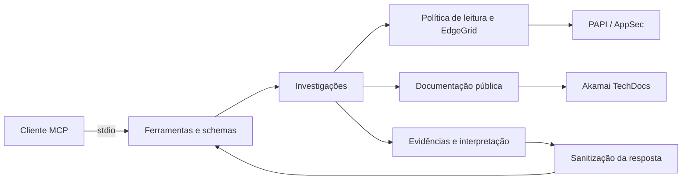

# Arquitetura

O servidor conecta um cliente MCP às APIs de leitura da Akamai. O cliente inicia o processo e troca mensagens JSON-RPC por stdio; o servidor autentica as consultas com EdgeGrid e devolve resultados estruturados.

## Organização

| Diretório | Responsabilidade |
| --- | --- |
| `src/configuration` | Credenciais, opções de execução e metadados do pacote |
| `src/mcp` | Registro das ferramentas, schemas de entrada e contrato de saída |
| `src/application` | Consultas de properties, segurança, documentação e composição de investigações |
| `src/domain` | Operações permitidas, paginação, diferenças estruturais, regras, hostnames e erros |
| `src/infrastructure` | HTTP, assinatura EdgeGrid, acesso às APIs, documentação e sanitização |

`src/index.ts` valida a configuração e inicia o transporte. O registro MCP utiliza o SDK TypeScript e os schemas utilizam Zod. A versão anunciada pelo servidor é lida de `package.json`.

## Contrato de resposta

As ferramentas retornam o mesmo envelope em `structuredContent` e em texto JSON. O envelope inclui `schemaVersion`, `tool`, `timestamp`, `status`, `evidence`, `inferences`, `unavailable`, `limitations`, `errors`, `coverage`, `nextActions` e `redaction`. Panorama, cobertura e próximas ações precedem os detalhes na serialização.

| Campo | Significado |
| --- | --- |
| `evidence` | Dados ligados à fonte, operação e recurso consultados, com contexto e paginação |
| `inferences` | Interpretações produzidas pelas regras da investigação, separadas dos dados da fonte |
| `unavailable` | Componentes que não puderam ser consultados e seus motivos |
| `limitations` | Restrições relevantes para interpretar o resultado |
| `errors` | Falhas gerais da operação |
| `coverage` | Completude do panorama e dos detalhes, continuações, fontes indisponíveis e limites de conclusão |
| `nextActions` | Próximas tools e argumentos, com motivos e necessidade para detalhes exaustivos |

`status` distingue `success`, `partial` e `error`. Uma consulta composta pode preservar evidências disponíveis e indicar as falhas em `unavailable`. `isError` acompanha `status=error`; entradas rejeitadas pelo SDK podem usar o erro padrão MCP.

A busca `search_properties_by_domain` combina leituras GET por grupos e properties com um filtro local dos nomes. Retorna somente candidatas, fontes, cobertura do lote e cursor de continuação, sem materializar todo o inventário no contexto do agente. O tamanho do lote respeita o orçamento configurado; erros de escopo preservam resultados disponíveis e deixam a cobertura parcial. A busca não utiliza o endpoint POST de pesquisa PAPI.

A confirmação CDN retorna em `inferences` uma classificação `hostname_association`: `CONFIRMED`, `NOT_MATCHED` ou `UNKNOWN`, acompanhada da próxima ação. A classificação usa o hostname exato e a versão ativa retornados por PAPI; para properties convencionais, combina o vínculo de edge hostname da rede com a versão ativa dos metadados. Uma versão informada na atribuição do hostname tem precedência. Dados insuficientes resultam em `UNKNOWN`; erros ficam em `unavailable`. `get_hostname_overview` só consulta segurança quando solicitado explicitamente. `explain_cdn_behavior` verifica o vínculo antes de ler regras; candidatas descartadas não geram evidências de cache para o hostname.

## Versões e regras

PAPI mantém `latestVersion`, `productionVersion` e `stagingVersion`. Application Security possui sua própria sequência de versões. O seletor padrão é produção; versões explícitas identificam o conteúdo consultado sem comprovar ativação.

As árvores de regras preservam hierarquia, critérios ancestrais e JSON Pointers. Comparações ordenam chaves de objetos e preservam a ordem dos arrays. São diferenças estruturais, sujeitas a mudanças entre as leituras. O servidor não avalia regras na borda nem expande includes, Advanced Metadata, EdgeWorkers ou Cloudlets.

## Consultas e ciclo de vida

A paginação é explícita. As ferramentas usam os parâmetros das APIs ou recortes em memória, conforme a fonte. URLs de continuação não são executadas diretamente.

O transporte controla tempo, tentativas, concorrência e volume de dados. Cada tentativa autenticada recebe uma nova assinatura. Cancelamento MCP e encerramento do processo interrompem requisições e esperas pendentes. Redirecionamentos são recusados.

Os resultados refletem o escopo e a disponibilidade das fontes no momento da consulta.

## Fluxos investigativos

`explain_cdn_behavior` calcula um panorama de toda a árvore recebida antes de selecionar o foco e paginar os detalhes. O foco padrão é compacto; cache, origin, headers e all oferecem aprofundamentos. O panorama preserva a existência de exceções condicionais mesmo quando sua evidência detalhada fica na última página. Paths contextualizam a investigação; não são um motor de avaliação de critérios.

O servidor constrói orientações de continuação para as 18 tools usando o escopo e a paginação de cada evidência. Páginas pendentes produzem status partial e próximas ações. O panorama de CDN ou a contagem de diferenças pode estar completo enquanto os detalhes permanecem paginados. Nenhuma conclusão de unicidade deriva da busca por nomes.

Configurações grandes no modo auto retornam um outline com pointers para aprofundar, sem nova chamada à API. Comparações produzem contagens de todas as diferenças antes de paginar. Históricos aplicam a janela temporal antes da paginação e preservam registros sem horário com timeWindowMembership=UNKNOWN. Seções de segurança declaram seu escopo; definições e ações de rate limiting são relacionadas por ID nas páginas disponíveis.
